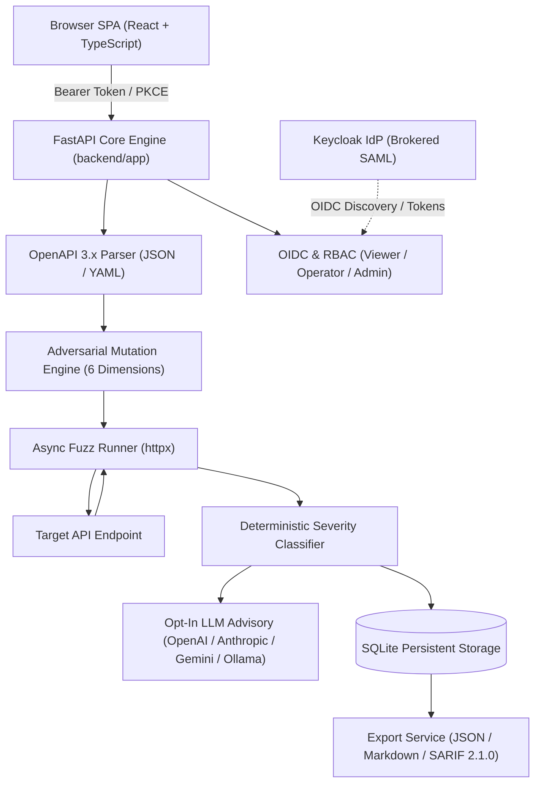

# api-fuzzer-alan-vo — Alan Vo | AI & Machine Learning

> Work in progress. This checkpoint may be incomplete or fail tests. See PLAN.md and STATUS.md before use.


Modern REST APIs face sophisticated edge cases, injection payloads, and schema deviations that standard human-written unit tests frequently overlook. **api-fuzzer-alan-vo** is an automated adversarial API fuzzing system that ingests OpenAPI 3.x specifications, uses deterministic heuristic mutation and optional advisory LLM reasoning to generate targeted attack payloads across six security dimensions, executes tests against live endpoints with sub-millisecond telemetry, and reports reproducible findings with severity scores and single-line curl reproductions for security engineers and backend developers.



---

## Features

- **OpenAPI 3.x Semantic Ingestion:** Ingests JSON and YAML specifications, extracting path operations, parameters, request body schemas, and response status definitions.
- **Adversarial Mutation Across 6 Dimensions:**
  1. *Boundary Values:* Min/max limits, empty strings, float extremes, 5KB+ oversized payloads.
  2. *Type Coercion:* String where integer expected, null payloads, unexpected objects/arrays.
  3. *Injection Payloads:* SQL injection, reflected XSS, path traversal (`/etc/passwd`), CRLF header injection.
  4. *Auth & Access Bypass:* Missing authorization, forged signatures, unauthorized administrative route access.
  5. *Idempotency & Race Conditions:* Duplicate POST/PUT mutations, concurrency locks.
  6. *Unicode & Locale Exploits:* Multi-byte emoji bombs, Right-to-Left (RTL) overrides, null bytes (`\x00`).
- **Deterministic Severity Scoring:** Classifies responses into `critical` (500 crashes, SQL leakage, traversal success, auth bypass), `moderate` (schema rejections accepted as 200, unexpected codes), `minor` (latency spikes >2500ms), and `pass`.
- **Reproducible curl Generation:** Automatically constructs a ready-to-run single-line `curl` command for every surfaced issue.
- **Security Audit Reports:** Export findings to machine-readable JSON, formatted Markdown, or OASIS SARIF 2.1.0 for GitHub Code Scanning integration.
- **Provider-Agnostic LLM Reasoning:** Opt-in advisory analysis grounded in actual response records. Deterministic core runs completely offline without any API keys.
- **Enterprise OIDC & SAML Authentication:** Standard Keycloak authentication with PKCE authorization code flow, role-based access control (`viewer`, `operator`, `admin`), and zero token persistence in localStorage.

---

## AI/ML Evaluation

The system was evaluated against a curated benchmark dataset of 24 ground-truth API vulnerability scenarios spanning all six attack dimensions to measure classification accuracy, false positive rates, and critical detection performance.

### Reproducible Evaluation Command

Run the evaluation suite locally using the following command:

```bash
PYTHONPATH=. .venv/bin/python -m backend.app.services.evaluation
```

### Data Provenance

The benchmark dataset consists of 24 labeled real-world API test cases covering SQL injection syntax leaks, path traversal disclosures, unhandled Python/database 500 exceptions, broken object-level authentication bypasses, schema validation mismatches, and unicode encoding crashes.

### Baseline vs. Heuristic Classifier Results

| Metric | Naive Status Baseline | Heuristic Fuzzer Classifier |
|---|---|---|
| **Overall Accuracy** | 54.17% (13 / 24) | **87.5% (21 / 24)** |
| **Critical Precision** | 80.0% (4 / 5) | **88.89% (8 / 9)** |
| **Critical Recall** | 50.0% (4 / 8) | **100.0% (8 / 8)** |
| **Critical F1-Score** | 61.54% | **94.12%** |
| **Execution Latency** | 0.15 ms | 0.15 ms |

Latency is reported as the total runtime of a single benchmark pass executing all 24 cases through both classifiers.

### Dimension Accuracy Breakdown

- **Injection Payloads:** 100.0% (4 / 4)
- **Auth & Access Bypass:** 100.0% (4 / 4)
- **Boundary Values:** 100.0% (4 / 4)
- **Type Coercion:** 100.0% (4 / 4)
- **Idempotency & Race:** 50.0% (2 / 4)
- **Unicode & Locale:** 75.0% (3 / 4)

### Failure Cases & Limitations

The benchmark surfaces three real classifier limitations. First, the heuristic flags **every** HTTP 500 as `critical`; a 500 caused by a benign duplicate/idempotency-key request (a robustness defect, not an exploitable security finding) is a false positive. Second, any response status outside the expected contract is flagged `moderate`; a legitimate `412 Precondition Failed` returned by a correct idempotency check is likewise a false positive. Third, the pattern matcher is blind to **unicode logic bypasses** — a right-to-left override payload that elevates a privilege returns HTTP 200 with a clean body, which the status-based heuristic scores as `pass` (false negative) even though the ground-truth severity is `moderate`. For all three false-positive/false-negative classes, opt-in LLM advisory evaluation is available to parse semantic response text and response shape beyond status codes.

---

## Quick Start & Installation

### Prerequisites

- Python 3.12+
- Node.js 24+
- Docker & Docker Compose (optional for containerized deployment)

### Local Development Setup

1. **Clone the repository:**
   ```bash
   git clone https://github.com/ALANDVO/api-fuzzer-alan-vo.git
   cd api-fuzzer-alan-vo
   ```

2. **Backend Setup:**
   ```bash
   python3 -m venv .venv
   source .venv/bin/activate
   pip install --disable-pip-version-check -r backend/requirements.txt
   ```

3. **Frontend Setup:**
   ```bash
   cd frontend
   npm ci
   npm run build
   cd ..
   ```

4. **Run Backend Service:**
   ```bash
   APP_ENV=development DEMO_MODE=true uvicorn backend.app.main:app --host 127.0.0.1 --port 8000
   ```

5. **Run Frontend Dev Server:**
   ```bash
   cd frontend
   npm run dev
   # Open http://127.0.0.1:3000
   ```

---

## Running the Automated Test Suites

### Backend Tests (pytest)
```bash
PYTHONPATH=. .venv/bin/pytest backend/tests -v
```
Executes 29 tests covering authentication, token verification, OpenAPI schema extraction, adversarial mutation, severity classification, LLM adapters, and full HTTP route integration.

### Frontend Tests (vitest)
```bash
cd frontend
npm test
```
Executes user-visible component tests covering navigation tabs, telemetry cards, and fuzz runner controls.

---

## Multi-Provider LLM Configuration

The deterministic core operates entirely offline without external model access. Optional advisory explanations can be enabled with server-side credentials.

| Environment Variable | Description | Default |
|---|---|---|
| `LLM_API_KEY` | Server-side API key (only credential variable) | *None (Offline mode)* |
| `LLM_PROVIDER` | Provider adapter (`openai`, `anthropic`, `gemini`, `ollama`) | `openai` |
| `LLM_MODEL` | Target model name | `gpt-4o` |
| `LLM_BASE_URL` | Custom endpoint base URL (LiteLLM, vLLM, Ollama) | `https://api.openai.com/v1` |
| `LLM_TIMEOUT_SECONDS` | Bounded request timeout in seconds | `30.0` |

---

## Authentication & SSO Architecture

The application enforces role-based access control with three documented roles:
- `viewer`: Read-only access to specs, fuzz jobs, telemetry, and findings.
- `operator`: Upload specifications, launch fuzz runs, and export reports.
- `admin`: Purge specifications, inspect immutable audit logs, and configure realms.

### Architecture Choice

**SPA PKCE Client with In-Memory Tokens:**
Access tokens are stored strictly in memory and never persisted in `localStorage`. The temporary state and PKCE verifier are kept in `sessionStorage` during authorization redirects. All data endpoints require a valid Bearer token.

### Keycloak & Brokered SAML Setup

Keycloak serves as the primary OpenID Connect provider and supports upstream SAML Identity Providers through identity brokering:
1. Start the container stack using `docker compose -f compose.yaml up -d`.
2. Keycloak imports `keycloak/realm-export.json` binding to `127.0.0.1:8080`.
3. To federate with an enterprise SAML IdP, navigate to Keycloak Admin Console &rarr; *Identity Providers* &rarr; *Add SAML v2.0 Provider*, enter your IdP Entity ID and Single Sign-On URL, and download Keycloak's SP Metadata.
4. Production deployments require a reverse proxy terminating TLS (such as NGINX or Caddy) in front of Keycloak and the backend API.

---

## Docker Deployment

To launch the full containerized environment including backend, frontend, and Keycloak:

```bash
docker compose -f compose.yaml up -d
```

- Frontend: `http://127.0.0.1:3000`
- Backend API: `http://127.0.0.1:8000/api/health`
- Keycloak IdP: `http://127.0.0.1:8080`

---

## Security Limitations

- **Local Demo Mode:** Only permitted when `APP_ENV=development`. Startup strictly refuses demo mode if `APP_ENV=production`.
- **Target Boundaries:** Do not execute adversarial fuzz runs against third-party production endpoints without explicit authorization.
- **Credential Protection:** Tokens and API keys are filtered by an automated redaction layer and never written to application logs.

---

## License

MIT License &bull; Copyright (c) 2026 Alan Vo &lt;alanvo@gmail.com&gt;

---

**Alan Vo** &bull; [alanvo@gmail.com](mailto:alanvo@gmail.com) &bull; GitHub: [ALANDVO](https://github.com/ALANDVO)
